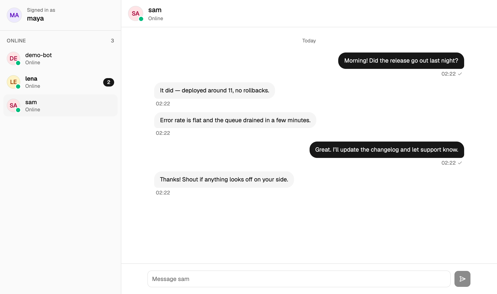
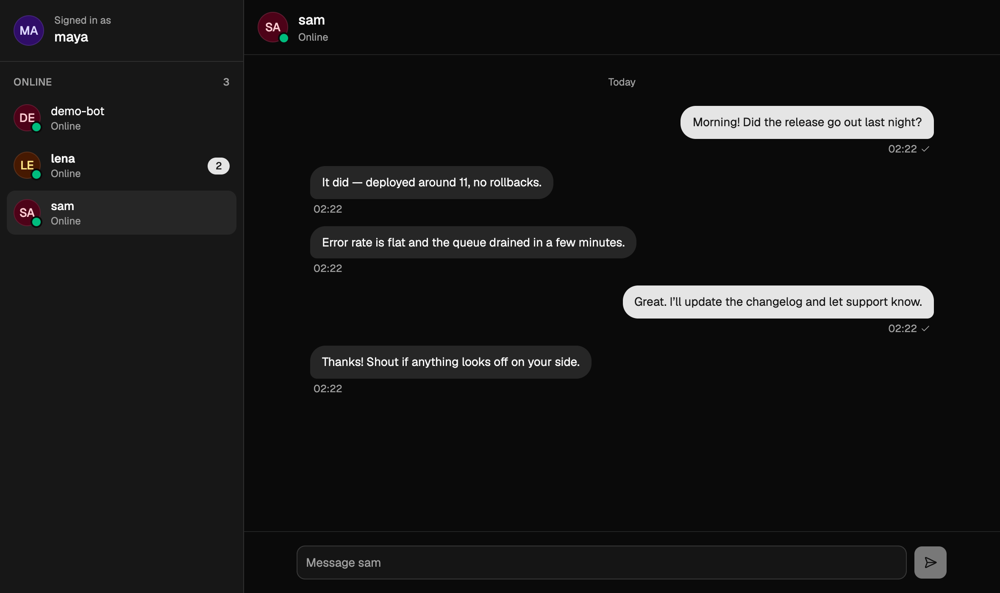
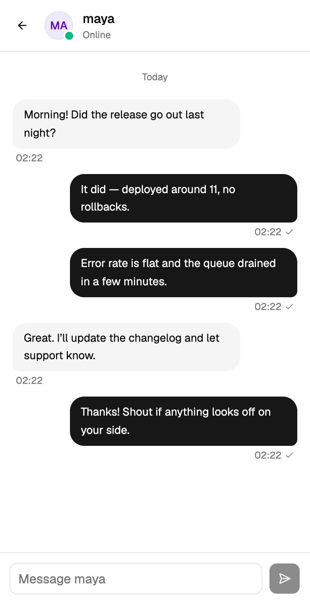
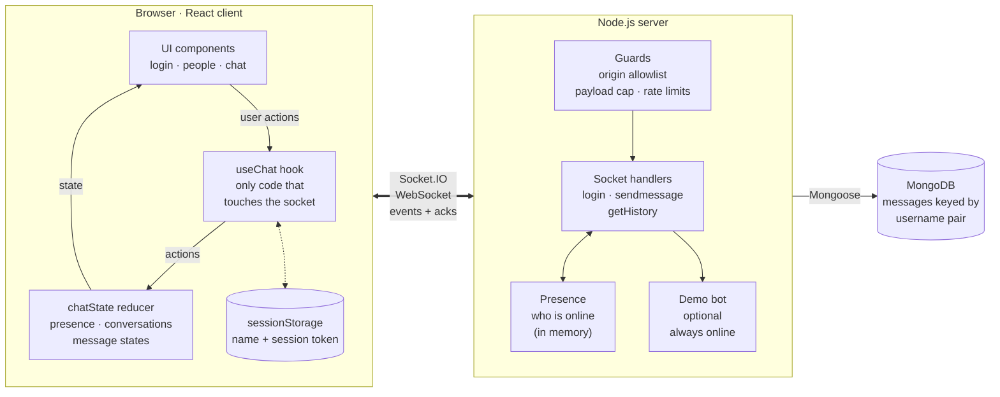

# Strive Chat

[](https://github.com/Nando-C/StriveM8D8/actions/workflows/ci.yml)

A real-time, one-to-one chat application: a Node.js + Socket.IO server with MongoDB persistence, and a React + TypeScript client. Messages go to exactly one recipient, conversations are saved, and the app keeps working through dropped connections, server restarts and page reloads.



<table>
  <tr>
    <td width="72%"></td>
    <td width="28%"></td>
  </tr>
  <tr>
    <td align="center"><sub>Dark theme, following the system setting</sub></td>
    <td align="center"><sub>Phone layout</sub></td>
  </tr>
</table>

## Highlights

- **Private by construction.** Each message is delivered into the recipient's own socket room and nowhere else; a test asserts that a third connected user receives nothing.
- **Conversations that persist.** History is stored in MongoDB per pair of users and reloads when a conversation is opened, including after either side reconnects.
- **Built for unreliable networks.** The client reconnects and signs back in by itself, catches up on messages it missed, and never shows a message twice or loses one that was not sent.
- **Honest about delivery.** Every message the user sends is shown as sending, sent, or not sent with the reason. Nothing fails silently.
- **Stays up when things break.** If the database is unreachable the server keeps running and keeps showing who is online; only sending and history report an error, and the connection is retried until it returns.
- **Accessible and responsive.** Usable from the keyboard alone, announced to screen readers, laid out for desktop and phone, with light and dark themes and motion that is switched off when the system asks for reduced motion.
- **130 automated tests**, run on every push by GitHub Actions on two Node.js versions.

## Tech stack

| Area | Technologies |
|------|--------------|
| Server | Node.js, Express 4, Socket.IO 4, Mongoose 9, MongoDB |
| Client | React 19, TypeScript, Vite, Tailwind CSS 4, shadcn/ui (Radix), Motion |
| Testing | Vitest, Testing Library, in-memory MongoDB, real Socket.IO clients |
| Tooling | pnpm, oxlint, GitHub Actions |

## Architecture



**Client.** Components never talk to the socket. A single hook, `useChat`, receives socket events and turns them into actions for a pure reducer, `chatState`, which holds presence, every conversation and the state of each message. The reducer has no socket, storage or timers in it, which makes every rule about merging and ordering messages testable in isolation.

**Server.** Every connection passes the guards first: an origin allowlist applied to the WebSocket handshake, a payload size cap, and per-socket rate limits. The socket handlers validate each payload, keep the list of who is online in memory, and read and write messages through Mongoose. The server is built by a `createApp()` function that neither listens nor connects to a database, so tests can start a fresh, isolated instance for every case.

**Between them.** One WebSocket connection carries everything: logins, messages with acknowledgements, history, and presence. The client makes no HTTP requests to the server.

<details>
<summary><strong>Repository layout</strong></summary>

Two independent packages in one repository: the server at the root, the client in `client/`. Each has its own `package.json` and lockfile; they share nothing but the protocol.

```
src/                        SERVER
├── index.js                Bootstrap only: create the app, connect to MongoDB, listen
├── app.js                  createApp() — builds Express + HTTP server + Socket.IO, no side effects
├── db.js                   connectDB() with retry, isDatabaseReady()
├── routes.js               REST routes (GET /online-users)
├── bot.js                  The demo bot's identity and replies
├── rateLimit.js            Sliding-window rate limiter
├── sockets/index.js        All socket events; owns the online-users state for its app instance
└── models/message.js       Message model and the conversation key helper
test/                       Server integration tests (real socket clients, in-memory MongoDB)

client/                     CLIENT
└── src/
    ├── App.tsx             Login screen or chat shell
    ├── components/         LoginForm, Sidebar, MessageList, MessageComposer, ConnectionBanner, …
    │   └── ui/             shadcn/ui components (source files, see below)
    ├── hooks/useChat.ts    The only code that touches the socket
    ├── lib/chatState.ts    Every state change, as a pure reducer
    ├── lib/                socket, session storage, motion timings, formatting
    ├── types/protocol.ts   The wire protocol as TypeScript types
    └── test/               Client tests (the real app against a fake socket)
```

</details>

## Engineering decisions

The parts of this project that took the most thought, and why they are the way they are.

**History is keyed by the pair of usernames, not by connection.** Socket.IO gives every connection a new id, so anything stored against a socket id is unreachable after a reload. Each conversation is stored under its two usernames, sorted and joined, which makes it the same key from both sides and across any number of reconnects.

**Presence travels only over the socket.** A client receives a snapshot of who is online when it logs in, then an event each time someone arrives or leaves. Because all of these arrive in order on one connection, the list can never be overwritten by a slower HTTP response that is already out of date.

**A session token makes reconnection safe.** When a connection drops without a clean close (a laptop sleeping, a network change), the browser reconnects within seconds, but the server still lists the old connection until its heartbeat times out. Usernames must be unique, so the user's own automatic re-login would be refused as "already in use". Each login therefore returns a random token; presenting it on the next login lets the same client take over its own stale entry.

**Every message has two ids.** The server's id lets the client merge live messages with loaded history without showing anything twice. A second id, generated by the client, covers the case where a message was saved but its acknowledgement was lost in a disconnect: the sender never learned the server's id, but still recognises its own message when it comes back in history, and marks it sent instead of showing it twice or leaving it as failed.

**Acknowledgements instead of error events.** Every send is answered through Socket.IO's acknowledgement callback, so a failure is tied to the exact message that failed. The client sets a timeout on it, because without one a message whose connection dropped would stay "sending" forever.

**The server degrades instead of failing.** Handlers check the database connection before using it and answer immediately when it is down, rather than queueing work and timing out. The first connection is retried with backoff, since the database driver does not retry a failed first attempt by itself.

**Motion that never blocks.** Animations use only transforms and opacity, are kept short, and never delay a state change. Loaded history appears as one block rather than a hundred staggered entrances, and with the system's reduced-motion setting on, movement is removed entirely.

## Quality

| | Server | Client |
|---|---|---|
| Tests | 82, in 10 files | 48, in 6 files |
| Approach | Real Socket.IO clients against a fresh server per test, with an in-memory MongoDB | The real app rendered against a fake socket; each test plays the server |
| Lint | oxlint | oxlint, including React hooks rules |
| Types | — | TypeScript, checked on every build |

- **CI** runs lint, both test suites and the client build on every push and pull request, on Node 22 and Node 24 (`.github/workflows/ci.yml`).
- **The tests were themselves tested.** For each suite the code was broken on purpose — a check removed, a message broadcast instead of targeted, the token comparison skipped — to confirm that a test fails each time. That exercise exposed, and led to fixing, a test helper that was passing without proving anything.
- **Server tests cover** login and username rules, session takeover, presence, targeted delivery, every send-failure path, malformed payloads, the origin allowlist, rate limits and the payload cap, the demo bot, message expiry, history ordering and its 100-message cap, and behaviour when the database is down, has never connected, or comes back.
- **Client tests cover** logging in and being refused, the people list through arrivals, reconnects and departures, exactly-once merging of live messages and history, unread counts, both kinds of acknowledgement, lost acknowledgements, re-login with the session token, the stored session, and being signed in from another tab. Elements are found by role and label, the way assistive technology finds them.

```bash
pnpm test               # server
cd client && pnpm test  # client
```

Neither suite needs anything running. The server suite downloads a MongoDB binary the first time; after that each suite takes a few seconds.

## Getting started

You need:

- **Node.js 22.22 or newer** (CI runs on Node 22 and 24)
- **[pnpm](https://pnpm.io)** — the version is pinned in each `package.json`; `corepack enable pnpm` sets it up
- **A MongoDB database** — a local `mongod` or a hosted cluster

```bash
# 1. Server (repository root)
pnpm install
cp .env.example .env                  # then fill in the values below

# 2. Client
cd client
pnpm install
cp .env.example .env                  # then set VITE_BACKEND_URL
cd ..

# 3. Run both
pnpm dev:all
```

Then open the address Vite prints (by default `http://localhost:5173`). To try a conversation on your own, open it in a second tab and join with a different name.

`pnpm dev:all` runs the two dev servers side by side with labelled output. They can also be started separately: `pnpm dev` in the root for the server, `pnpm dev` in `client/` for the client.

### Environment variables

Server — `.env` in the repository root:

| Variable | Required | Description |
|----------|----------|-------------|
| `PORT` | No | Port to listen on. Defaults to `3001`. |
| `FRONTEND_URL` | For browser clients | Comma-separated list of origins allowed to connect. It must include the client's origin, e.g. `http://localhost:5173` (a trailing slash is fine). Requests with no `Origin` header (non-browser clients) are always allowed. If unset, no browser origin is allowed. |
| `DEMO_BOT` | No | Set to `true` to add the always-online [demo bot](#demo-bot). Off by default. |
| `MESSAGE_TTL_HOURS` | No | A positive number makes MongoDB delete each message that many hours after it was sent; `0` turns expiry off. Left unset, the database's current setting is not touched — so a development machine pointed at a shared database cannot change it by accident. |
| `MONGO_CONNECTION` | For messaging | MongoDB connection string, including the database name. If unset or unreachable the server still runs and serves presence; sending and history fail with a clear error, and the connection is retried until it succeeds. A malformed connection string is reported once and not retried. |

Client — `client/.env`:

| Variable | Required | Description |
|----------|----------|-------------|
| `VITE_BACKEND_URL` | Yes | Address of the server, e.g. `http://localhost:3001`. It is built into the client at build time, so changing it means restarting the dev server or rebuilding. |

If the client stays on "Connecting…", the usual cause is that its origin is missing from the server's `FRONTEND_URL`.

### Scripts

Server (repository root):

| Command | What it does |
|---------|--------------|
| `pnpm dev` | Start the server with automatic reload on file changes |
| `pnpm start` | Start the server with plain `node` |
| `pnpm dev:all` | Start the server and the client dev server together |
| `pnpm test` | Run the server test suite |
| `pnpm lint` | Lint `src/` and `test/` with oxlint |

Client (`client/`):

| Command | What it does |
|---------|--------------|
| `pnpm dev` | Start the Vite dev server |
| `pnpm build` | Type-check and build for production into `client/dist` |
| `pnpm preview` | Serve the production build locally |
| `pnpm test` | Run the client test suite |
| `pnpm lint` | Lint with oxlint |

## Protocol reference

Connect with any Socket.IO v4 client. Browser clients must come from an origin listed in `FRONTEND_URL`.

### Client → server

| Event | Payload | Reply |
|-------|---------|-------|
| `login` | `{ username, sessionToken? }` | `loggedin` or `loginError` |
| `sendmessage` | `{ toUserId, text, clientId }` + acknowledgement callback | The acknowledgement (below) |
| `getHistory` | `{ withUsername }` | `history` or `historyError` |

- `username`: 1–30 characters from `A–Z a–z 0–9 _ -`. Must not already be online (unless reclaimed with a `sessionToken`, see [Engineering decisions](#engineering-decisions)).
- `toUserId`: the recipient's current socket id, as given in the online-users list.
- `text`: 1–2000 characters.
- `clientId`: an id the client generates for each message (for example a UUID); 1–64 characters from `A–Z a–z 0–9 -`.

`sendmessage` is always answered through its acknowledgement callback:

```js
{ ok: true, id, timestamp }     // saved, and delivered if the recipient is still online; id is the stored message's id
{ ok: false, message }          // nothing was saved or delivered
```

Failure messages: `Invalid message`, `Not logged in`, `Cannot message yourself`, `Recipient is not online`, `Message could not be saved`, `Too many requests, slow down`.

### Server → client

| Event | Sent to | Payload | Meaning |
|-------|---------|---------|---------|
| `loggedin` | The socket that logged in | `{ username, id, sessionToken, onlineUsers }` | Login accepted. `onlineUsers` is the current list (`{ username, id }[]`, including you). `sessionToken` is private to this client. |
| `loginError` | The socket that tried | `{ message }` | `Invalid username`, `Username already in use`, `Already logged in`, or `Too many requests, slow down`. |
| `newLogin` | Everyone else | `{ username, id }` | A user came online, or an online user now has a new socket id. Treat as an upsert by username. |
| `userLeft` | Everyone else | `{ id }` | The user with that socket id went offline. |
| `message` | The recipient only | `{ id, from, fromId, text, timestamp }` | A message for you. `from` is the sender's username, `fromId` their socket id. |
| `history` | The requester only | `{ withUsername, messages }` | The most recent 100 messages of that conversation, oldest first. Each is `{ id, clientId, from, to, text, timestamp }`. |
| `historyError` | The requester only | `{ withUsername, message }` | `Invalid username`, `Not logged in`, `History could not be loaded`, or `Too many requests, slow down`. |

`timestamp` is milliseconds since the Unix epoch. The same message has the same `id` and `timestamp` in the live `message` event, in the sender's acknowledgement, and in `history`. `clientId` is `null` in history for messages that were not sent by a client.

`disconnect` is Socket.IO's built-in event; there is no logout event. Closing the connection takes the user offline.

### Limits

The server is meant to be reachable by anyone, with no accounts, so each socket is rate-limited: 10 messages per 10 seconds, 10 history requests per 10 seconds, and 5 logins per 10 seconds. A request over the limit is refused with `Too many requests, slow down` and has no other effect. A single socket payload may not exceed 10 kB; a connection that sends more is closed.

### Demo bot

With `DEMO_BOT=true` the server adds a user called `demo-bot` who is always online and answers every message after a short pause, so that someone who opens the app alone has somebody to talk to. To clients it is an ordinary user — it appears in the online list, its conversation is stored and reloaded like any other — and the protocol has no special case for it. The name `demo-bot` is reserved whether or not the bot is switched on.

### REST

| Method | Path | Response |
|--------|------|----------|
| `GET` | `/online-users` | `{ onlineUsers: [{ username, id }] }` |

Clients do not need this endpoint — presence arrives over the socket, and the client in this repository never calls it — but it is handy for inspection. Unknown routes return `404` with a JSON body.

## Known limitations

- **No authentication.** Usernames are unique among users who are online, but there are no passwords: anyone can log in under a name that is currently offline and read that name's history. It is a demo, not a place for private conversations.
- **Online recipients only.** A message can only be sent to a user who is connected; there is no offline delivery queue.
- **History is capped** at the most recent 100 messages per conversation.
- **Single instance.** The list of who is online lives in the server's memory, so the server cannot be scaled to several instances as it stands.

### What would come next

- **Accounts**, so that a name belongs to one person and history is private.
- **Delivery to offline users**, with unread counts that survive a reload.
- **Horizontal scaling**, moving presence into Redis and using Socket.IO's Redis adapter.
- **End-to-end browser tests in CI.** During development the app was checked with scripted Chrome sessions, including cutting a connection without the server noticing; those belong in the repository.

## Background

This began as a bootcamp exercise at Strive School: build a one-to-one chat on top of Socket.IO's per-socket rooms, with a list of users and their previous messages. The first version, written during the course, used two shared rooms and stored nothing. It was later rebuilt to do what the brief asked for, and then taken further: a redesigned protocol, persistence, a new client, tests and CI.
