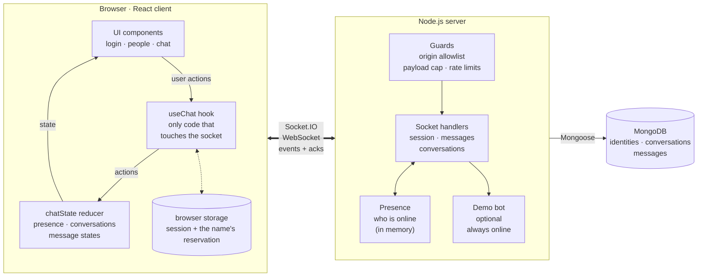

# Strive Chat

[](https://github.com/Nando-C/StriveM8D8/actions/workflows/ci.yml)

A real-time, one-to-one chat application: a Node.js + Socket.IO server with MongoDB persistence, and a React + TypeScript client. Messages go to exactly one recipient, conversations are saved, and the app keeps working through dropped connections, server restarts and page reloads.

**Live demo:** <https://strive-chat.vercel.app> — pick any name and message **demo-bot**, who is always online, or open the page in a second tab under another name and talk to yourself. The demo runs on free hosting, so the first connection can take up to a minute while the server wakes.


## Highlights

- **Private by construction.** A message goes to the members of its conversation and nobody else, and who the members are is read from the stored conversation — never from anything a client sends. Tests assert that a third connected user receives nothing, and that knowing a conversation's id opens nothing.
- **Conversations that wait for you.** A message can be sent to someone who is offline; they find it, counted as unread, when they come back — on any device. History loads a page at a time, and a conversation opens at the first message you have not read.
- **Built for unreliable networks.** The client reconnects and signs back in by itself, catches up on messages it missed, and never shows a message twice or loses one that was not sent.
- **Honest about delivery.** Every message you send shows how far it has got: sending, one tick when it is saved, two when it has reached the other person's device, two coloured ticks when they have read it — or not sent, with the reason. Nothing fails silently, and "read" means read: the page visible, in front, and scrolled to the message.
- **Stays up when things break.** If the database is unreachable the server keeps running, and whoever is logged in stays logged in and keeps seeing who is online; sending, history and new logins report an error worth retrying, and the connection is retried until it returns. If the server itself is slow to start, the client says it is waking rather than looking broken.
- **Accessible and responsive.** Usable from the keyboard alone, announced to screen readers, laid out for desktop and phone, with light and dark themes and motion that is switched off when the system asks for reduced motion.
- **Guests and accounts.** Type a name and you are in, with that name kept for your browser; or create an account with a password and use it from several devices at once — with a list of those devices, remote sign-out, and a recovery code in place of an email address.
- **Status that means something.** Online, away (also set by itself after five minutes without activity, and only when *every* one of your devices is idle), do not disturb, and invisible — plus a line of your own that can clear itself after a while. Invisible is real: to everyone else you are indistinguishable from someone who is not connected, yet you can read and write as usual.
- **Group chats.** Up to twenty people, made in two clicks. Each message says who wrote it, the ticks say when *everyone* has it — press them to see who has seen it — and membership is handled the way people expect: anyone can add or leave, the creator can rename and remove, someone added later sees the conversation from that point on, and someone removed loses it at once.
- **626 automated tests**, 30 of them driving real browsers against the built app, run on every push by GitHub Actions on two Node.js versions.

## Tech stack

| Area | Technologies |
|------|--------------|
| Server | Node.js, Express 4, Socket.IO 4, Mongoose 9, MongoDB |
| Client | React 19, TypeScript, Vite, Tailwind CSS 4, shadcn/ui (Radix), Motion |
| Testing | Vitest, Testing Library, in-memory MongoDB, real Socket.IO clients |
| Tooling | pnpm, oxlint, GitHub Actions |

## Architecture



**Client.** Components never talk to the socket. A single hook, `useChat` (with `useSessionLogin`, which it uses for logging in), receives socket events and turns them into actions for a pure reducer (the account dialogs send their own requests through one small helper, `ask`), `chatState`, which holds presence, every conversation and the state of each message. The reducer has no socket, storage or timers in it, which makes every rule about merging and ordering messages testable in isolation.

**Server.** Every connection passes the guards first: an origin allowlist applied to the WebSocket handshake, a payload size cap, and per-socket rate limits. The socket handlers validate each payload, take the sender's identity from the server's own state (never from the payload), check membership against the stored conversation, keep the list of who is connected in memory, and read and write through Mongoose. The server is built by a `createApp()` function that neither listens nor connects to a database, so tests can start a fresh, isolated instance for every case.

**Between them.** One WebSocket connection carries everything: logins, messages with acknowledgements, history, and presence. The client makes no HTTP requests to the server.

<details>
<summary><strong>Repository layout</strong></summary>

Three independent packages in one repository: the server at the root, the client in `client/`, and the end-to-end tests in `e2e/`. Each has its own `package.json` and lockfile; server and client share nothing but the protocol, and the server's production install carries no browser.

```
src/                        SERVER
├── index.js                Bootstrap only: create the app, connect to MongoDB, listen
├── app.js                  createApp() — builds Express + HTTP server + Socket.IO, no side effects
├── db.js                   connectDB() with retry, isDatabaseReady()
├── settings.js             Everything that differs between deployments, from the environment
├── routes.js               REST routes (GET /online-users, GET /config, GET /health)
├── bot.js                  The demo bot's identity and replies
├── rateLimit.js            Sliding-window rate limiter
├── clientAddress.js        A client's real address behind trusted proxies
├── auth/                   Password hashing (queued scrypt), secrets, guessing limits
├── sockets/
│   ├── index.js            Wires everything onto each connection
│   ├── messages.js         Sending, history, delivery to every device with its own acknowledgement, receipts
│   ├── groups.js           Creating a group, adding and removing members, leaving, renaming, succession
│   ├── session.js          Guests and accounts: login, sign-up, passwords, hourly housekeeping
│   ├── deviceSessions.js   The devices an account is signed in on, and ending them
│   ├── guesses.js          Limits on guessing a password, recovery code or bootstrap code
│   ├── invitations.js      Invitations, as administrators create, list and revoke them
│   ├── status.js           Choosing a status, idle reports, the timer that clears a status text
│   └── presence.js         Who is connected, who can see it, and announcing exactly what changed
├── conversations.js        Conversation ids, what a member may see, the one view sent to clients
├── positions.js            Positions in a conversation: { timestamp, id } pairs and their order
├── status.js               What a user chooses to show, and the one rule for what others then see
└── models/                 Conversation, Message, Identity, Session (a signed-in device), Invitation
test/                       Server integration tests (real socket clients, in-memory MongoDB)

client/                     CLIENT
└── src/
    ├── App.tsx             Entry screen or chat shell
    ├── components/         EntryScreen, account/ (menu and dialogs), groups/ (new group, details, people picker), Sidebar, MessageList, MessageComposer, ConnectionBanner, …
    │   └── ui/             shadcn/ui components (source files, see below)
    ├── hooks/useChat.ts    Connects the chat to the socket: presence, messages, read reports
    ├── hooks/useSessionLogin.ts  Who this tab is: logging in, back in after a reconnect, and out
    ├── lib/chatState.ts    Every state change, as a pure reducer (with chatSelectors.ts, messages.ts)
    ├── lib/                socket, requests, stored sessions, server config, motion timings, formatting
    ├── types/protocol.ts   The wire protocol as TypeScript types
    └── test/               Client tests (the real app against a fake socket)

e2e/                        END-TO-END TESTS
├── stack.js                Starts one whole deployment: MongoDB, the server, the built client
├── profiles.js             The two deployments tested: public demo and private
├── playwright.config.js    One project per profile
└── tests/                  Specs, and helpers.js: what a person does, in the tests' words
```

</details>

## Engineering decisions

The parts of this project that took the most thought, and why they are the way they are.

**A person is an id; a conversation is a list of members.** Every identity has a permanent random `userId`, and its username is only a label. A conversation is a stored document with a list of member ids, and that list is the single thing that decides who may read or write there. The id of a one-to-one conversation is built from its two user ids, so either side can work it out and open the chat without asking the server — but the server never authorises anything by reading an id: a test files a conversation under an id that names somebody else, and that somebody still cannot get in. It also means a name that is later freed and taken by another person brings none of its previous owner's conversations with it.

**Read positions are a pair, not a timestamp.** How far someone has read, and where a page of history ends, are stored as a message's timestamp *and* id, compared in the same order history is sorted by. A timestamp alone cannot separate two messages saved in the same millisecond: one would be skipped or repeated at a page boundary, or miscounted as read. A test pages through 230 messages that all share one instant and gets each exactly once. Positions only ever move forward, enforced inside the database update itself.

**One function decides what others see of you.** What a user has chosen (online, away, do not disturb, invisible), whether they are idle, and what everybody else is consequently shown are three different things, and the mapping between them lives in one pure function with a test for every combination. Everything that announces presence goes through one routine that compares how a user was shown before a change with how they are shown after it, and sends exactly the difference — a `presence` update, an arrival, a departure, or nothing. That is what makes invisible trustworthy: an invisible user's "before" and "after" are both "not shown", so nothing they do — changing their text, going idle, connecting a second device, logging in tomorrow — produces any event at all. A test lets an invisible user do all of it while another client records everything it receives.

**Ticks are computed, not stored.** There is no "delivered" or "seen" flag on any message. Each member of a conversation has two positions — how far they have received, how far they have read — and a tick is the answer to "is this message at or before the other person's position?", asked with the same timestamp-and-id comparison as everything else. One update when someone reads a hundred messages, instead of a hundred. Delivery is recorded per device: the server sends each connection its own copy with its own acknowledgement, because a single broadcast comes back as a bundle of acknowledgements that cannot be attributed to anybody.

**Invisible stays invisible in the data, too.** Holding back the live "seen" event would not be enough: the sender's next reload would fetch the stored position and colour the ticks anyway. So every member has *two* sets of positions — the true one, sent only to themself (their own unread counts depend on it), and a published one, which is all anyone else is ever sent. While someone is invisible the published set stands still; when they are visible again it catches up, with one event.

**One view of a conversation.** Everything a client is told about a conversation — at login, when it is created, when something changes — is built by one function, for one recipient at a time. So a rule about what a member may see (for a group: nothing from before they joined, not even in the list preview or the unread count) is written once and cannot be forgotten in one event and kept in another.

**Presence travels only over the socket.** A client receives a snapshot of who is online when it logs in, then an event each time someone arrives or leaves. Because all of these arrive in order on one connection, the list can never be overwritten by a slower HTTP response that is already out of date.

**A name belongs to whoever can prove it.** A guest types a name and is in; the server reserves that name to their browser by handing over a random secret, once, and storing only its hash. An account proves its name with a password instead, from any device, on several at once. Either way a person is a permanent random id inside the server and the name is only its label, so a name that is later freed and taken by someone else does not bring the previous owner's identity with it. The same proof makes reconnection safe: when a connection drops without a clean close, the server still lists the old one until its heartbeat times out, and the returning client takes over from it rather than being told its own name is in use.

**Nothing half-made.** Creating an account touches three things — the name, the password, and the first device session — and returns a recovery code that exists nowhere else. The order is chosen so that no failure in between can leave an account whose code nobody was shown: the device session is stored first and taken back if the account cannot be, and the client waits three times as long for these answers as for any other. A new guest name works the same way: it is provisional until the browser confirms it received the secret.

**Passwords without a mail server.** Accounts have no email address, so there is nothing personal to store and nothing to send. Passwords are hashed with scrypt from Node's standard library, using one of the lower-memory settings from OWASP's guidance (about 32 MiB per hash) and a queue that runs two at a time, because the server this runs on has 512 MB in all. Forgetting a password is covered by a recovery code shown once at sign-up. Wrong guesses are slowed per client address and per address-and-name pair — counted from the moment a check starts, so that a burst sent all at once cannot get in ahead of the count — never per name alone: anyone can read a name in the sidebar, and must not be able to lock its owner out by guessing at it.

**Every message has two ids.** The server's id lets the client merge live messages with loaded history without showing anything twice. A second id, generated by the client, covers the case where a message was saved but its acknowledgement was lost in a disconnect: the sender never learned the server's id, but still recognises its own message when it comes back in history, and marks it sent instead of showing it twice or leaving it as failed.

**Acknowledgements instead of error events.** Every send is answered through Socket.IO's acknowledgement callback, so a failure is tied to the exact message that failed. The client sets a timeout on it, because without one a message whose connection dropped would stay "sending" forever.

**The server degrades instead of failing.** Handlers check the database connection before using it and answer immediately when it is down, rather than queueing work and timing out. The first connection is retried with backoff, since the database driver does not retry a failed first attempt by itself.

**Motion that never blocks.** Animations use only transforms and opacity, are kept short, and never delay a state change. Loaded history appears as one block rather than a hundred staggered entrances, and with the system's reduced-motion setting on, movement is removed entirely.

## Quality

Three suites, each testing what the others cannot.

| | Server | Client |
|---|---|---|
| Tests | 345, in 18 files | 251, in 13 files |
| Approach | Real Socket.IO clients against a fresh server per test, with an in-memory MongoDB | The real app rendered against a fake socket; each test plays the server |
| Lint | oxlint | oxlint, including React hooks rules |
| Types | — | TypeScript, checked on every build |

- **CI** runs lint, both unit suites and the client build on every push and pull request, on Node 22 and Node 24, and the browser suite on Node 24 (`.github/workflows/ci.yml`). When a browser test fails, its trace — every step, with the page as it was — is kept as an artifact.
- **The tests were themselves tested.** For each suite the code was broken on purpose — a check removed, a message broadcast instead of targeted, the token comparison skipped — to confirm that a test fails each time. That exercise exposed, and led to fixing, a test helper that was passing without proving anything.
- **Server tests cover** login and username rules, guest names and their expiry, accounts (sign-up, sign-in, several devices, revoking a device, password change, recovery, deletion, turning a guest into an account), invitations and administrator names, guessing limits, that no secret reaches another client or a log, session takeover, presence, targeted delivery, every send-failure path, malformed payloads, the origin allowlist, rate limits and the payload cap, the demo bot, message expiry, history ordering and its 100-message cap, and behaviour when the database is down, has never connected, or comes back.
- **Client tests cover** logging in and being refused, the people list through arrivals, reconnects and departures, exactly-once merging of live messages and history, unread counts, both kinds of acknowledgement, lost acknowledgements, the three ways in and which of them a deployment offers, sign-in and sign-up with the recovery code shown once, a forgotten password, the account menu (devices, password change, invitations, signing out, deletion, a guest becoming an account), re-login with the name's reservation or the device session, the stored session, waiting for a server that is not ready, being signed out by the server, and being signed in from another tab. Elements are found by role and label, the way assistive technology finds them.
- **End-to-end tests** (`e2e/`, Playwright with Chromium) start the whole thing the way it is deployed — an in-memory MongoDB, the real server, and the client built for production and served from its own origin — and drive two to four browsers at once. They cover:
  - a guest name being refused from another browser and kept for its own;
  - two tabs as two people;
  - someone leaving and vanishing from the list promptly;
  - a conversation arriving exactly once on both sides;
  - a message waiting for someone who is away, and the "New messages" line when they return;
  - reload restoring everything;
  - a third person seeing nothing;
  - the bot;
  - paging back through more than a hundred messages without losing your place;
  - accounts on two browsers with remote sign-out, recovery and deletion;
  - a guest becoming an account;
  - a group of four: made, talked in, joined later (and seeing nothing earlier), renamed, someone removed, the admin leaving and the next taking over;
  - phone-sized screens.

  A second, smaller run uses the private-deployment settings: no guest path, sign-up refused without an invitation, the owner's bootstrap link, an invitation link that works exactly once, and writing to a member who is offline. The suite is run twice in a row before it is trusted, and has no retries: a test that passes on the second attempt is a flaky test.

```bash
pnpm test               # server
cd client && pnpm test  # client
```

Neither suite needs anything running. The server suite downloads a MongoDB binary the first time; after that each suite takes a few seconds.

## Getting started

You need:

- **Node.js 22 (22.22 or newer) or 24** — the two versions CI runs on
- **[pnpm](https://pnpm.io)** — the version is pinned in each `package.json`; `corepack enable pnpm` sets it up
- **A MongoDB database** — a local `mongod` or a hosted cluster

```bash
# 1. Server (repository root)
pnpm install
cp .env.example .env                  # then fill in the values below

# 2. Client
cd client
pnpm install
cp .env.example .env                  # then set VITE_BACKEND_URL
cd ..

# 3. Run both
pnpm dev:all
```

Then open the address Vite prints (by default `http://localhost:5173`). To try a conversation on your own, open it in a second tab and join with a different name.

`pnpm dev:all` runs the two dev servers side by side with labelled output. They can also be started separately: `pnpm dev` in the root for the server, `pnpm dev` in `client/` for the client.

### Environment variables

Server — `.env` in the repository root:

| Variable | Required | Description |
|----------|----------|-------------|
| `PORT` | No | Port to listen on. Defaults to `3001`. |
| `FRONTEND_URL` | For browser clients | Comma-separated list of origins allowed to connect. It must include the client's origin, e.g. `http://localhost:5173` (a trailing slash is fine). Requests with no `Origin` header (non-browser clients) are always allowed. If unset, no browser origin is allowed. |
| `DEMO_BOT` | No | Set to `true` to add the always-online [demo bot](#demo-bot). Off by default. |
| `MESSAGE_TTL_HOURS` | No | A positive number makes MongoDB delete each message that many hours after it was sent, and each conversation that long after its last message; guest names lapse after the same time without a visit. `0` turns expiry off (guest names then lapse after 30 days). Left unset, the database's current setting is not touched — so a development machine pointed at a shared database cannot change it by accident. |
| `MONGO_CONNECTION` | Yes | MongoDB connection string, including the database name. If unset or unreachable the server still runs and answers its health check, but nobody can log in; for people already logged in, sending and history fail with a clear error. The connection is retried until it succeeds. A malformed connection string is reported once and not retried. |
| `SIGNUP_MODE` | No | Who may create an account: `open` (default), `invite` (only with an invitation from an administrator) or `closed`. An unrecognised value closes sign-up. |
| `GUESTS` | No | Set to `false` to require an account. By default a name alone is enough to get in. With guests off, `GET /online-users` answers `404`. |
| `ADMIN_USERNAMES` | No | Comma-separated names reserved for administrators. Nobody can take them as a guest or register them without `SIGNUP_BOOTSTRAP_CODE`. |
| `SIGNUP_BOOTSTRAP_CODE` | No | A secret, chosen by whoever runs the deployment, that registers the names in `ADMIN_USERNAMES` as administrators. While it is unset those names cannot be registered at all. To use it, open the client at `/?bootstrap=<the code>` and create the account there; the code is taken from the link and removed from the address bar afterwards. |
| `MEMBER_DIRECTORY` | No | `online` (default): people can start a chat with whoever is connected. `all`: accounts are also shown every other account, connected or not (up to 200) — for a private deployment, where otherwise you could never write to someone who is not online at that moment. Guests are never sent the list. |
| `TRUSTED_PROXY_HOPS` | When behind a proxy | How many proxies stand between the internet and the server (default `0`). Limits on sign-ups and wrong passwords are counted per client address; behind a hosting platform's proxy every visitor appears to come from the proxy unless this is set, and they would all share one limit. Too high a number lets a client forge its address. Not every host documents this: use `PROXY_CHECK` to find the value. |
| `PROXY_CHECK` | No | Set to `true` while setting up a host. It adds `GET /proxy-check`, which shows whoever asks how their own request arrived and which address each value of `TRUSTED_PROXY_HOPS` would take them for. Open it from a browser, compare with your real public address, set the hops that give it, and remove this setting again. |

Client — `client/.env`:

| Variable | Required | Description |
|----------|----------|-------------|
| `VITE_BACKEND_URL` | Yes | Address of the server, e.g. `http://localhost:3001`. It is built into the client at build time, so changing it means restarting the dev server or rebuilding. |

If the client stays on "Connecting…", the usual cause is that its origin is missing from the server's `FRONTEND_URL`.

### Scripts

Server (repository root):

| Command | What it does |
|---------|--------------|
| `pnpm dev` | Start the server with automatic reload on file changes |
| `pnpm start` | Start the server with plain `node` |
| `pnpm dev:all` | Start the server and the client dev server together |
| `pnpm test` | Run the server test suite |
| `pnpm lint` | Lint `src/` and `test/` with oxlint |
| `pnpm e2e` | Run the end-to-end browser suite (see below) |

Client (`client/`):

| Command | What it does |
|---------|--------------|
| `pnpm dev` | Start the Vite dev server |
| `pnpm build` | Type-check and build for production into `client/dist` |
| `pnpm preview` | Serve the production build locally |
| `pnpm test` | Run the client test suite |
| `pnpm lint` | Lint with oxlint |

End-to-end (`e2e/`, a third independent package):

```bash
pnpm --dir e2e install
pnpm --dir e2e exec playwright install chromium   # once: downloads the browser
pnpm e2e                                          # from the repository root
```

It needs the server's and the client's dependencies installed too, and ports 4100, 4101, 4110 and 4111 free. Nothing has to be running beforehand: the suite starts its own database, servers and client builds, and stops them afterwards. It takes about two minutes, most of it one test that has to send over a hundred messages at the rate the server allows. After a failure, `pnpm --dir e2e exec playwright show-report` opens the report with a trace of each failed test.

## Deployment

The app deploys as three separate pieces. Nothing in the repository is tied to a particular provider.

| Piece | What it needs from a host |
|-------|---------------------------|
| **Database** | A hosted MongoDB cluster |
| **Server** (repository root) | A host that runs a long-lived Node.js process and accepts WebSocket connections. Serverless function platforms do not qualify: the socket connection has to stay open. |
| **Client** (`client/`) | Any static file host |

### Order

1. **Database.** Create the cluster and a database user with read and write access to one database only. Allow connections from the server's host. If that host has no fixed outbound address you will have to allow all addresses, which leaves the database password as the only protection — use a long random one.
2. **Server.** Deploy it and note its public `https://` URL. `FRONTEND_URL` can be left empty for now.
3. **Client.** Build it with `VITE_BACKEND_URL` set to the server's URL, publish it, and note its public URL.
4. **Back to the server.** Set `FRONTEND_URL` to the client's URL and restart. Until this is done the client stays on "Waking the server…", because the server refuses its origin.

### Server settings

| Setting | Value |
|---------|-------|
| Root directory | the repository root |
| Install command | `pnpm install --frozen-lockfile` |
| Start command | `pnpm start` |
| Health check path | `/health` |
| Instances | **1** — see [Known limitations](#known-limitations) |
| `MONGO_CONNECTION` | the cluster's connection string, ending in the database name |
| `FRONTEND_URL` | the client's origin, e.g. `https://chat.example.com` |
| `DEMO_BOT` | `true` |
| `MESSAGE_TTL_HOURS` | `24` |
| `TRUSTED_PROXY_HOPS` | the number of proxies your host puts in front of the server — see [Environment variables](#environment-variables) |
| `PORT` | leave unset; hosts provide it |

### Client settings

| Setting | Value |
|---------|-------|
| Root directory | `client` |
| Install command | `pnpm install --frozen-lockfile` |
| Build command | `pnpm build` |
| Publish directory | `client/dist` (`dist` if the root directory is already `client`) |
| `VITE_BACKEND_URL` | the server's `https://` URL. It is compiled into the build, so changing it means rebuilding. |

The client has no routes of its own, so no rewrite or fallback rules are needed. Both packages pin their pnpm version in `package.json` (`packageManager`); check how your host picks that up.

### Worked example: Atlas, Render and Vercel

This is the combination the live demo runs on, all on free tiers. The notes below were checked against each provider's documentation in November 2026; dashboards and free-tier terms change, so treat the provider docs as the authority.

**1. MongoDB Atlas — the database.** Create a cluster, a database user limited to read and write on one database, and copy the connection string, ending it with the database name. Leave the IP access list for step 2.

**2. Render — the server**, as a *Web Service* from this repository.

| Field | Value |
|-------|-------|
| Language | Node |
| Root Directory | leave empty (the repository root) |
| Build Command | `pnpm install --frozen-lockfile` |
| Start Command | `pnpm start` |
| Health check path (under Advanced) | `/health` |
| Environment variables | `MONGO_CONNECTION`, `DEMO_BOT=true`, `MESSAGE_TTL_HOURS=24`; `FRONTEND_URL` after step 3 |

- **Node version.** Render picks it from `engines` in `package.json`, which here allows 22 and 24, so it runs the newest Node 24. (An open-ended range would resolve to whatever Node is newest, which this project is not tested on.)
- **Database access.** A Render service calls out from a shared range of addresses for its region, listed under the service's **Connect → Outbound** tab. Add those ranges to the Atlas project's IP access list instead of allowing every address.
- **Sleeping.** A free web service is stopped after 15 minutes without inbound traffic and takes about a minute to start again on the next request. An open chat tab keeps it awake; the client's "Waking the server…" notice covers the wait for the first visitor. Free services share a monthly allowance of instance hours per workspace.
- **Optional:** under **Build Filters**, ignore `client/**`, `docs/**` and `README.md`, so that a change to the client alone does not restart the server and disconnect everyone.

**3. Vercel — the client**, as a project from the same repository.

| Field | Value |
|-------|-------|
| Root Directory | `client` |
| Framework Preset | Vite (detected) |
| Build Command / Output Directory | the defaults: `pnpm build` and `dist` |
| Environment variables | `VITE_BACKEND_URL` = the Render service's `https://` URL, and `ENABLE_EXPERIMENTAL_COREPACK` = `1` |

- **pnpm version.** Vercel chooses a pnpm version from the lockfile's format, which here would be an older major than the one this project pins. With `ENABLE_EXPERIMENTAL_COREPACK=1` it uses the version named in `package.json` instead.
- **Node version.** Taken from `engines` in `client/package.json`: the newest Node 24.
- **Preview deployments** get their own URLs, which are not in the server's `FRONTEND_URL`, so a preview build loads but cannot connect. Only the production domain is allowed.

**4. Back on Render,** set `FRONTEND_URL` to the Vercel production URL (for example `https://your-project.vercel.app`) and let the service restart.

### After deploying

- `https://<server>/health` answers `{ "status": "ok", "db": "up" }`.
- The client loads, shows `demo-bot` after you join, and the bot answers.
- Two browsers under different names can exchange messages.

## Protocol reference

Connect with any Socket.IO v4 client, passing the protocol version in the handshake: `io(url, { auth: { protocol: 2 } })`. Any other version is refused with a `connect_error` whose `data` is `{ code: "protocol", protocol: 2 }`; the client in this repository then asks the user to reload. Browser clients must come from an origin listed in `FRONTEND_URL`.

People are identified by a permanent `userId`; usernames are labels. No event carries a socket id.

### Client → server

| Event | Payload | Reply |
|-------|---------|-------|
| `login` | one of the three forms below | `loggedin` or `loginError` |
| `sendmessage` | `{ conversationId, text, clientId }` + acknowledgement callback | The acknowledgement (below) |
| `getHistory` | `{ conversationId, before? }` | `history` or `historyError` |
| `markRead` | `{ conversationId, upTo }` + acknowledgement callback | `{ ok: true }` or `{ ok: false, message }` |
| `setStatus` | `{ status?, text?, clearAfterMinutes? }` + acknowledgement callback | `{ ok: true, status, statusText, statusClearAt }` or `{ ok: false, message }` |
| `setIdle` | `{ idle }` + acknowledgement callback | `{ ok: true }` or `{ ok: false, message }` |
| `createGroup` | `{ name, userIds }` + acknowledgement callback | `{ ok: true, conversationId }` or `{ ok: false, message }` |
| `addMembers` | `{ conversationId, userIds }` + acknowledgement callback | `{ ok: true }` or `{ ok: false, message }` |
| `removeMember` | `{ conversationId, userId }` + acknowledgement callback | `{ ok: true }` or `{ ok: false, message }` — the group's admin only |
| `leaveGroup` | `{ conversationId }` + acknowledgement callback | `{ ok: true }` or `{ ok: false, message }` |
| `renameGroup` | `{ conversationId, name }` + acknowledgement callback | `{ ok: true }` or `{ ok: false, message }` — the group's admin only |

`login` has three forms:

| Form | Payload | What happens |
|------|---------|--------------|
| Guest | `{ username, reservation? }` | A free name is reserved to this client: `loggedin` carries a `reservation` secret, once. A name already reserved needs that secret. An account's name is refused. |
| Account, with password | `{ username, password, deviceLabel? }` | Creates a session for this device and returns it as `session` in `loggedin`. |
| Account, with a session | `{ session, sessionToken? }` | Logs in with a device session from an earlier sign-in or sign-up. `sessionToken` (from this device's previous `loggedin`) makes a reconnect replace its old connection rather than count as one more. |

- `username`: 1–30 characters from `A–Z a–z 0–9 _ -`. A name is one name whatever its case: `Alice` and `alice` cannot both exist, and whoever holds it keeps the spelling they first chose, however they type it to log in.
- `password`: 8–128 characters, no other rules.
- A guest has one connection at a time: logging in again with the reservation replaces the old one. An account may have up to five.
- `conversationId`: for a one-to-one conversation, `dm:<userIdA>::<userIdB>` with the two ids in sorted order — both sides can build it, so no request is needed to open a chat. The conversation is created by its first message; the other person must exist but does not have to be online. An id is only a name: access is decided by the conversation's stored members.
- `text`: 1–2000 characters, not only whitespace.
- `clientId`: an id the client generates for each message (for example a UUID); 1–64 characters from `A–Z a–z 0–9 -`.
- `before`, `upTo`: a *position*, `{ ts, id }` — a message's `timestamp` and `id`. `before` asks for the page of history that ends just before it. `upTo` says how far the conversation has been read; it only ever moves forward, and never past the last message. The client in this repository sends it only while the conversation is really being read — the page visible, the window in front, the newest message on screen — and at most once a second. Reading also counts as having received. A message is recorded as *delivered* when a device acknowledges it, and when a login hands a device its conversation list.

- `status`: `online`, `away`, `dnd` or `invisible`. `text`: up to 80 characters, `""` to remove it. `clearAfterMinutes`: how long the text stays, from 1 minute to a week; `null` or absent keeps it until it is changed. Only what is given changes. The choice is stored with the identity, so it is the same after a reload and on every device.
- `idle`: whether nobody is using this connection's page. The client in this repository sends `true` after five minutes without input and `false` at the next input. A user is shown as away only while *all* of their connections are idle, and only if what they chose is `online`.

#### Groups

A group is a conversation with a name, an admin and up to 20 members; its id is `group:<uuid>`, given by the server. Sending, history, read positions and receipts work in it exactly as in a one-to-one conversation.

- `name`: 1–50 characters. `userIds`: the other people — each must exist (the demo bot counts, where it is on). Guests and accounts can both create and be in groups.
- Whoever creates a group is its **admin**: only they can rename it or remove someone. Any member can add people, and anyone can leave. When the admin leaves, the member who has been in the group longest takes over; when the last person leaves, the group and its messages are deleted. The bot is never the admin and never the last person.
- **Someone added later sees only what comes after they were added** — in history, in the unread count and in the list preview. Someone removed, or who left, loses access at once: they are sent `conversationRemoved`, and from then on the group is an `Unknown conversation` to them. Added again, they start afresh from that moment.
- Every change is recorded in the group as a message of `kind: "system"`, with no text and a `data` object for the client to put into words: `{ event: "created", actor, name, targets }`, `{ event: "added", actor, targets }`, `{ event: "removed", actor, target }`, `{ event: "left", actor }`, `{ event: "renamed", actor, name }` — `actor`, `target` and each of `targets` being `{ userId, username }` as they were at the time. These are not counted as unread.
- When membership or the name changes, each member is first sent `conversationUpdated` and then the system `message`. The exception is the people an `added` line is about: it is where they begin, so they are sent the group but not the line.
- Limits: 20 groups created per user (counted while its creator is still in it, and only against its creator: leaving one gives the place back), 200 groups per member — adding someone who is already in 200 is refused to whoever tries. The 20 holds exactly; the 200 is checked just before the change, so requests made at the same instant can pass it by a few.
- A person whose identity is removed (an account deleted, a guest name that lapsed) leaves every group they were in, as if they had left themselves.

Failure messages: `A group name must be 1 to 50 characters`, `Choose at least one other person`, `Unknown user`, `A group can have at most 20 members`, `Already in this group`, `Not in this group`, `Only the group admin can do that`, `To go yourself, leave the group`, `You have created 20 groups — leave one first`, `You are in too many groups`, `One of these people is in too many groups`, `The group changed in the meantime — try again`, `Unknown conversation`, `Not logged in`, `Could not be saved`, `Too many requests, slow down`.

`sendmessage` is always answered through its acknowledgement callback:

```js
{ ok: true, id, timestamp }     // saved; delivered now to whoever is connected, and waiting for whoever is not
{ ok: false, message }          // nothing was saved or delivered
```

Failure messages: `Invalid message`, `Not logged in`, `Unknown conversation` (it does not exist, or you are not in it — deliberately the same answer), `This person is no longer here`, `Message could not be saved`, `Too many requests, slow down`.

#### Accounts

Each of these is answered through its acknowledgement callback, with `{ ok: true, … }` or `{ ok: false, message }`. A failure may also carry `retryable: true` (the server could not check right now) or `retryAfterMs` (too many wrong guesses).

| Event | Payload | On success | Who |
|-------|---------|------------|-----|
| `register` | `{ username, password, reservation?, invitation?, deviceLabel? }` | `{ session, recoveryCode, kind, admin }`. Log in next with `{ session }`. With the `reservation` of a guest name (or from that guest's own connection) the guest becomes the account and keeps their conversations. `invitation` is required where sign-up is by invitation. | Anyone |
| `resetPassword` | `{ username, recoveryCode, newPassword }` | `{ recoveryCode }` — a new code; the old one is used up. Every device is signed out. | Anyone |
| `changePassword` | `{ currentPassword, newPassword }` | Every other device is signed out. | Accounts |
| `listSessions` | — | `{ sessions: [{ id, label, createdAt, lastUsedAt, current }] }` | Accounts |
| `revokeSession` | `{ id }` | That device is signed out and disconnected at once. | Accounts |
| `logout` | — | This device's session ends; the connection stays open, logged out. A guest keeps their reservation. | Logged in |
| `deleteAccount` | `{ password }` | The account, its sessions and its invitations are removed. | Accounts |
| `createInvitation` | — | `{ id, code, expiresAt }`. Single use, valid for 7 days; the code cannot be read back later. | Administrators |
| `listInvitations` | — | `{ invitations: [{ id, createdAt, expiresAt }] }` | Administrators |
| `revokeInvitation` | `{ id }` | | Administrators |

The recovery code is shown once and is the only way back into an account whose password is forgotten: there is no email address to send anything to. A wrong password and an unknown account get the same answer, as do a wrong recovery code and an unknown account.

### Server → client

| Event | Sent to | Payload | Meaning |
|-------|---------|---------|---------|
| `loggedin` | The socket that logged in, with an acknowledgement callback when a guest name was just reserved | `{ userId, username, kind, admin, sessionToken, ownStatus, onlineUsers, conversations, groupIds, members?, reservation?, session? }` | Login accepted. `ownStatus` is what you have chosen to show (`{ status, statusText, statusClearAt }`), which nobody else is sent. `onlineUsers` is everyone who can be seen (users, below) — including you, unless you are invisible. `conversations` is your 50 most recently active (conversations, below). `groupIds` is the id of every group you are in, listed or not: a client that was not connected when you were taken out of one learns it from its absence here. `members` is every account, sent only to accounts and only where `MEMBER_DIRECTORY=all`. `sessionToken`, `reservation` and `session` are private to this client. **Acknowledge it**: a newly reserved guest name is provisional until the browser confirms the secret arrived, and is given up if the connection closes first or no confirmation comes within ten seconds — otherwise a secret lost in transit would lock the name against its own owner. |
| `loginError` | The socket that tried | `{ message, retryable?, retryAfterMs?, sessionEnded? }` | For example `Invalid username`, `Username already in use`, `That name belongs to an account — sign in`, `Wrong username or password`, `Already logged in`, `Too many requests, slow down`. `retryable`: the server is still starting, try again shortly. `sessionEnded`: the device session no longer exists. |
| `sessionRevoked` | The sockets being signed out | `{ reason }` | This connection was signed out on purpose — its device was revoked, the password changed, the account deleted or the guest name expired — and is closed straight after. |
| `newLogin` | Everyone else who is logged in | a user | A user came online (or stopped being invisible), or who they are changed (a guest became an account). Treat as an upsert by `userId`. Sent once per user, however many devices they connect. |
| `userLeft` | Everyone who is logged in | `{ userId }` | That user's last connection closed — or they chose to be invisible. The two cannot be told apart, on purpose. |
| `presence` | Everyone else who is logged in | `{ userId, status, statusText }` | How a listed user is shown has changed: they chose another status or text, went idle on every device, or came back. |
| `ownStatus` | Your other connections | `{ status, statusText, statusClearAt }` | Your own status was changed on another of your devices, or its text ran out. |
| `message` | Every connection of every member, except the one it was sent from | a message, with an acknowledgement callback | A message in one of your conversations — including your own, sent from another of your devices. **Call the acknowledgement**: it is what records the message as delivered to you, and moves the sender's tick. Each connection is sent the message separately, so each acknowledgement belongs to one person. |
| `receipt` | The other members, on every connection | `{ conversationId, userId, deliveredUpTo, readUpTo }` | Another member has received or read further. Positions only move forward. This is what the ticks on your own messages are worked out from. Someone who joined a group later is not sent a position from before they joined (it would name an earlier message); for them it is `null`, here and in `members`. |
| `conversationUpdated` | Each member, separately | `{ conversation }` | A conversation is new to you or something about it changed (it was just created; the other person is gone; another of your devices read it; a group's members, admin or name changed). Replaces what you had. After the first message of a one-to-one conversation it arrives *after* the `message`; for a change to a group, *before* the system message that records it. |
| `conversationRemoved` | Every connection of someone who left a group or was removed from it | `{ id }` | You are no longer in that group: forget it. |
| `history` | The requester only | `{ conversationId, messages, hasMore }` | Up to 100 messages, oldest first. `hasMore`: there are earlier ones; ask again with `before` set to the first message's position. |
| `historyError` | The requester only | `{ conversationId, message }` | `Invalid conversation`, `Invalid position`, `Not logged in`, `Unknown conversation`, `History could not be loaded`, or `Too many requests, slow down`. |
| `memberJoined` / `memberLeft` | Accounts, where `MEMBER_DIRECTORY=all` | `{ userId, username, kind }` / `{ userId }` | An account was created or removed. |
| `memberDirectory` | A guest who has just become an account, where `MEMBER_DIRECTORY=all` | `{ members }` | The whole directory, which they were not entitled to a moment ago. |

The shapes used above:

```js
// a user, as others are shown them
{ userId, username, kind, status, statusText }
//  kind: "guest" | "account" | "bot"
//  status: "online" | "away" | "dnd" — never "invisible": an invisible user is not in any list
//  statusText: a line of their own, possibly empty

// a message — the same object live and in history
{ id, conversationId, from, fromName, kind, text, data?, timestamp, clientId }
//  from: the author's userId; fromName: their name when it was sent
//  kind: "text", or "system" for a change to a group — then text is null and data says what happened (see Groups)
//  clientId: the id you gave your own message, null on anyone else's

// a conversation, as you are shown it
{ id, kind, name?, admin?, members, lastMessage, unreadCount }
//  kind: "direct" | "group"; a group also has its name and its admin's userId, and lists its members in the order they joined
//  members: [{ userId, username, deliveredUpTo, readUpTo, joinedAfter?, gone? }]   (positions, or null)
//           your own entry holds your true positions; everyone else's hold what they let be known —
//           the same thing, except that an invisible member's stand still until they are visible again
//  lastMessage: { id, from, fromName, preview, timestamp, kind?, data? } | null
//           null also when the last message is from before you joined; kind and data only when it is not text
//  unreadCount: messages from others after your read position, at most 99 (system messages are not counted)
```

`timestamp` is milliseconds since the Unix epoch. The same message has the same `id` and `timestamp` in the live `message` event, in the sender's acknowledgement, and in `history`. A member marked `gone` no longer exists: the conversation is kept for the other person, who can read it but not add to it.

`disconnect` is Socket.IO's built-in event. Closing the connection takes that connection offline, and the user with it when it was their last; a guest's name stays reserved to their browser, and lapses after the message lifetime without a visit (30 days where messages do not expire).

### Limits

The server is meant to be reachable by anyone, so each socket is rate-limited (the server's own acknowledgement wait for a delivery is 10 seconds): 10 messages per 10 seconds, 10 history requests per 10 seconds, 30 read reports per 10 seconds, 10 status changes and 30 idle reports per 10 seconds, 10 group requests per 10 seconds of which at most 5 may add members, 5 logins per 10 seconds, and 5 requests per 10 seconds for anything that checks a password. A request over the limit is refused with `Too many requests, slow down` and has no other effect. A single socket payload may not exceed 10 kB; a connection that sends more is closed.

A new socket costs nothing, so what matters most is also limited per client address: 10 sign-ups and 30 new guest names an hour, and wrong passwords, recovery codes or bootstrap codes — after 5 for one name (20 in all) from an address, each further one has to wait twice as long as the last, up to 15 minutes. These counts are kept in memory and depend on `TRUSTED_PROXY_HOPS` being right for the host.

### Demo bot

With `DEMO_BOT=true` the server adds a user called `demo-bot` who is always online and answers every message after a short pause, so that someone who opens the app alone has somebody to talk to. To clients it is a user like any other — it appears in the online list (with `kind: "bot"`, so the interface can label it, always `online`, with a fixed status text), and its conversation is created, stored, counted as unread and reloaded exactly as one with a person would be. It can also be added to a group, where it answers only messages that mention `@demo-bot`, and is left out when working out whether everyone has received or read a message. The name `demo-bot` is reserved whether or not the bot is switched on.

### REST

| Method | Path | Response |
|--------|------|----------|
| `GET` | `/online-users` | `{ onlineUsers: [{ userId, username, kind }] }` — `404` where `GUESTS=false`, so a private deployment does not publish its members |
| `GET` | `/proxy-check` | Only with `PROXY_CHECK=true`: `{ connectionFrom, forwardedFor, addressWithHops, configuredHops, addressAsConfigured }` — how the asker's own request arrived |
| `GET` | `/config` | `{ signup: "open" \| "invite" \| "closed", guests: boolean, protocol: 2 }` — which ways in this deployment offers |
| `GET` | `/health` | `{ status: "ok", db: "up" \| "down" }` — always `200` while the process is alive, including when the database is down |

Clients do not need `/online-users` — presence arrives over the socket, and the client in this repository never calls it — but it is handy for inspection. `/config` is the one thing that client fetches over HTTP: it has to know which ways in to offer before anyone is logged in. Unknown routes return `404` with a JSON body.

## Known limitations

- **A forgotten password and a lost recovery code cannot be recovered.** There is no email address on an account, by design.
- **A group has one admin and no roles beyond that**, and its messages cannot be edited or deleted. The demo bot answers in a group only when mentioned.
- **At login a user is sent their 50 most recently active conversations.** Older ones still exist and receive messages, but are not listed until something happens in them.
- **Single instance.** The list of who is online lives in the server's memory, so the server cannot be scaled to several instances as it stands.
- **On the live demo:** messages are deleted automatically a day after they are sent, and because the server sleeps when idle on free hosting, the first visitor after a quiet spell waits for it to wake. The client says so while it waits.

### What would come next

- **File attachments, then one-to-one video calls.**
- **Horizontal scaling**, moving presence into Redis and using Socket.IO's Redis adapter.
- **More browsers.** The end-to-end suite runs in Chromium only; Firefox and WebKit would be a configuration change and a longer run.

## Background

This began as a bootcamp exercise at Strive School: build a one-to-one chat on top of Socket.IO's per-socket rooms, with a list of users and their previous messages. The first version, written during the course, used two shared rooms and stored nothing. It was later rebuilt to do what the brief asked for, and then taken further: a redesigned protocol, persistence, a new client, tests and CI.

## Author

Built by [Nando-C](https://github.com/Nando-C).

## License

[MIT](LICENSE)
