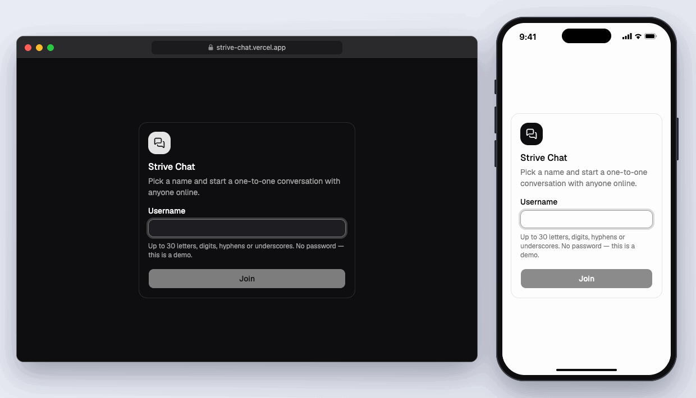
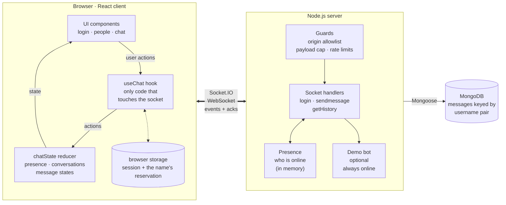

# Strive Chat

[](https://github.com/Nando-C/StriveM8D8/actions/workflows/ci.yml)

A real-time, one-to-one chat application: a Node.js + Socket.IO server with MongoDB persistence, and a React + TypeScript client. Messages go to exactly one recipient, conversations are saved, and the app keeps working through dropped connections, server restarts and page reloads.

**Live demo:** <https://strive-chat.vercel.app> — pick any name and message **demo-bot**, who is always online, or open the page in a second tab under another name and talk to yourself. The demo runs on free hosting, so the first connection can take up to a minute while the server wakes.



## Highlights

- **Private by construction.** Each message is delivered into the recipient's own socket room and nowhere else; a test asserts that a third connected user receives nothing.
- **Conversations that persist.** History is stored in MongoDB per pair of users and reloads when a conversation is opened, including after either side reconnects.
- **Built for unreliable networks.** The client reconnects and signs back in by itself, catches up on messages it missed, and never shows a message twice or loses one that was not sent.
- **Honest about delivery.** Every message the user sends is shown as sending, sent, or not sent with the reason. Nothing fails silently.
- **Stays up when things break.** If the database is unreachable the server keeps running, and whoever is logged in stays logged in and keeps seeing who is online; sending, history and new logins report an error worth retrying, and the connection is retried until it returns. If the server itself is slow to start, the client says it is waking rather than looking broken.
- **Accessible and responsive.** Usable from the keyboard alone, announced to screen readers, laid out for desktop and phone, with light and dark themes and motion that is switched off when the system asks for reduced motion.
- **Guests and accounts.** Type a name and you are in, with that name kept for your browser; or create an account with a password and use it from several devices at once — with a list of those devices, remote sign-out, and a recovery code in place of an email address.
- **277 automated tests**, run on every push by GitHub Actions on two Node.js versions.

## Tech stack

| Area | Technologies |
|------|--------------|
| Server | Node.js, Express 4, Socket.IO 4, Mongoose 9, MongoDB |
| Client | React 19, TypeScript, Vite, Tailwind CSS 4, shadcn/ui (Radix), Motion |
| Testing | Vitest, Testing Library, in-memory MongoDB, real Socket.IO clients |
| Tooling | pnpm, oxlint, GitHub Actions |

## Architecture



**Client.** Components never talk to the socket. A single hook, `useChat`, receives socket events and turns them into actions for a pure reducer, `chatState`, which holds presence, every conversation and the state of each message. The reducer has no socket, storage or timers in it, which makes every rule about merging and ordering messages testable in isolation.

**Server.** Every connection passes the guards first: an origin allowlist applied to the WebSocket handshake, a payload size cap, and per-socket rate limits. The socket handlers validate each payload, keep the list of who is online in memory, and read and write messages through Mongoose. The server is built by a `createApp()` function that neither listens nor connects to a database, so tests can start a fresh, isolated instance for every case.

**Between them.** One WebSocket connection carries everything: logins, messages with acknowledgements, history, and presence. The client makes no HTTP requests to the server.

<details>
<summary><strong>Repository layout</strong></summary>

Two independent packages in one repository: the server at the root, the client in `client/`. Each has its own `package.json` and lockfile; they share nothing but the protocol.

```
src/                        SERVER
├── index.js                Bootstrap only: create the app, connect to MongoDB, listen
├── app.js                  createApp() — builds Express + HTTP server + Socket.IO, no side effects
├── db.js                   connectDB() with retry, isDatabaseReady()
├── settings.js             Everything that differs between deployments, from the environment
├── routes.js               REST routes (GET /online-users, GET /config, GET /health)
├── bot.js                  The demo bot's identity and replies
├── rateLimit.js            Sliding-window rate limiter
├── clientAddress.js        A client's real address behind trusted proxies
├── auth/                   Password hashing (queued scrypt), secrets, guessing limits
├── sockets/
│   ├── index.js            Messages and history; wires everything onto each connection
│   ├── session.js          Guests, accounts, devices, invitations, hourly housekeeping
│   └── presence.js         Who is online: users and their connections, for one app instance
└── models/                 Message, Identity, Session (a signed-in device), Invitation
test/                       Server integration tests (real socket clients, in-memory MongoDB)

client/                     CLIENT
└── src/
    ├── App.tsx             Entry screen or chat shell
    ├── components/         EntryScreen, account/ (menu and dialogs), Sidebar, MessageList, MessageComposer, ConnectionBanner, …
    │   └── ui/             shadcn/ui components (source files, see below)
    ├── hooks/useChat.ts    Connects the chat to the socket: login, presence, messages
    ├── lib/chatState.ts    Every state change, as a pure reducer
    ├── lib/                socket, requests, stored sessions, server config, motion timings, formatting
    ├── types/protocol.ts   The wire protocol as TypeScript types
    └── test/               Client tests (the real app against a fake socket)
```

</details>

## Engineering decisions

The parts of this project that took the most thought, and why they are the way they are.

**History is keyed by the pair of usernames, not by connection.** Socket.IO gives every connection a new id, so anything stored against a socket id is unreachable after a reload. Each conversation is stored under its two usernames, sorted and joined, which makes it the same key from both sides and across any number of reconnects.

**Presence travels only over the socket.** A client receives a snapshot of who is online when it logs in, then an event each time someone arrives or leaves. Because all of these arrive in order on one connection, the list can never be overwritten by a slower HTTP response that is already out of date.

**A name belongs to whoever can prove it.** A guest types a name and is in; the server reserves that name to their browser by handing over a random secret, once, and storing only its hash. An account proves its name with a password instead, from any device, on several at once. Either way a person is a permanent random id inside the server and the name is only its label, so a name that is later freed and taken by someone else does not bring the previous owner's identity with it. The same proof makes reconnection safe: when a connection drops without a clean close, the server still lists the old one until its heartbeat times out, and the returning client takes over from it rather than being told its own name is in use.

**Passwords without a mail server.** Accounts have no email address, so there is nothing personal to store and nothing to send. Passwords are hashed with scrypt from Node's standard library, using one of the lower-memory settings from OWASP's guidance (about 32 MiB per hash) and a queue that runs two at a time, because the server this runs on has 512 MB in all. Forgetting a password is covered by a recovery code shown once at sign-up. Wrong guesses are slowed per client address and per address-and-name pair, never per name alone: anyone can read a name in the sidebar, and must not be able to lock its owner out by guessing at it.

**Every message has two ids.** The server's id lets the client merge live messages with loaded history without showing anything twice. A second id, generated by the client, covers the case where a message was saved but its acknowledgement was lost in a disconnect: the sender never learned the server's id, but still recognises its own message when it comes back in history, and marks it sent instead of showing it twice or leaving it as failed.

**Acknowledgements instead of error events.** Every send is answered through Socket.IO's acknowledgement callback, so a failure is tied to the exact message that failed. The client sets a timeout on it, because without one a message whose connection dropped would stay "sending" forever.

**The server degrades instead of failing.** Handlers check the database connection before using it and answer immediately when it is down, rather than queueing work and timing out. The first connection is retried with backoff, since the database driver does not retry a failed first attempt by itself.

**Motion that never blocks.** Animations use only transforms and opacity, are kept short, and never delay a state change. Loaded history appears as one block rather than a hundred staggered entrances, and with the system's reduced-motion setting on, movement is removed entirely.

## Quality

| | Server | Client |
|---|---|---|
| Tests | 171, in 13 files | 106, in 8 files |
| Approach | Real Socket.IO clients against a fresh server per test, with an in-memory MongoDB | The real app rendered against a fake socket; each test plays the server |
| Lint | oxlint | oxlint, including React hooks rules |
| Types | — | TypeScript, checked on every build |

- **CI** runs lint, both test suites and the client build on every push and pull request, on Node 22 and Node 24 (`.github/workflows/ci.yml`).
- **The tests were themselves tested.** For each suite the code was broken on purpose — a check removed, a message broadcast instead of targeted, the token comparison skipped — to confirm that a test fails each time. That exercise exposed, and led to fixing, a test helper that was passing without proving anything.
- **Server tests cover** login and username rules, guest names and their expiry, accounts (sign-up, sign-in, several devices, revoking a device, password change, recovery, deletion, turning a guest into an account), invitations and administrator names, guessing limits, that no secret reaches another client or a log, session takeover, presence, targeted delivery, every send-failure path, malformed payloads, the origin allowlist, rate limits and the payload cap, the demo bot, message expiry, history ordering and its 100-message cap, and behaviour when the database is down, has never connected, or comes back.
- **Client tests cover** logging in and being refused, the people list through arrivals, reconnects and departures, exactly-once merging of live messages and history, unread counts, both kinds of acknowledgement, lost acknowledgements, the three ways in and which of them a deployment offers, sign-in and sign-up with the recovery code shown once, a forgotten password, the account menu (devices, password change, invitations, signing out, deletion, a guest becoming an account), re-login with the name's reservation or the device session, the stored session, waiting for a server that is not ready, being signed out by the server, and being signed in from another tab. Elements are found by role and label, the way assistive technology finds them.

```bash
pnpm test               # server
cd client && pnpm test  # client
```

Neither suite needs anything running. The server suite downloads a MongoDB binary the first time; after that each suite takes a few seconds.

## Getting started

You need:

- **Node.js 22 (22.22 or newer) or 24** — the two versions CI runs on
- **[pnpm](https://pnpm.io)** — the version is pinned in each `package.json`; `corepack enable pnpm` sets it up
- **A MongoDB database** — a local `mongod` or a hosted cluster

```bash
# 1. Server (repository root)
pnpm install
cp .env.example .env                  # then fill in the values below

# 2. Client
cd client
pnpm install
cp .env.example .env                  # then set VITE_BACKEND_URL
cd ..

# 3. Run both
pnpm dev:all
```

Then open the address Vite prints (by default `http://localhost:5173`). To try a conversation on your own, open it in a second tab and join with a different name.

`pnpm dev:all` runs the two dev servers side by side with labelled output. They can also be started separately: `pnpm dev` in the root for the server, `pnpm dev` in `client/` for the client.

### Environment variables

Server — `.env` in the repository root:

| Variable | Required | Description |
|----------|----------|-------------|
| `PORT` | No | Port to listen on. Defaults to `3001`. |
| `FRONTEND_URL` | For browser clients | Comma-separated list of origins allowed to connect. It must include the client's origin, e.g. `http://localhost:5173` (a trailing slash is fine). Requests with no `Origin` header (non-browser clients) are always allowed. If unset, no browser origin is allowed. |
| `DEMO_BOT` | No | Set to `true` to add the always-online [demo bot](#demo-bot). Off by default. |
| `MESSAGE_TTL_HOURS` | No | A positive number makes MongoDB delete each message that many hours after it was sent; `0` turns expiry off. Left unset, the database's current setting is not touched — so a development machine pointed at a shared database cannot change it by accident. |
| `MONGO_CONNECTION` | Yes | MongoDB connection string, including the database name. If unset or unreachable the server still runs and answers its health check, but nobody can log in; for people already logged in, sending and history fail with a clear error. The connection is retried until it succeeds. A malformed connection string is reported once and not retried. |
| `SIGNUP_MODE` | No | Who may create an account: `open` (default), `invite` (only with an invitation from an administrator) or `closed`. An unrecognised value closes sign-up. |
| `GUESTS` | No | Set to `false` to require an account. By default a name alone is enough to get in. With guests off, `GET /online-users` answers `404`. |
| `ADMIN_USERNAMES` | No | Comma-separated names reserved for administrators. Nobody can take them as a guest or register them without `SIGNUP_BOOTSTRAP_CODE`. |
| `SIGNUP_BOOTSTRAP_CODE` | No | A secret, chosen by whoever runs the deployment, that registers the names in `ADMIN_USERNAMES` as administrators. While it is unset those names cannot be registered at all. |
| `TRUSTED_PROXY_HOPS` | When behind a proxy | How many proxies stand between the internet and the server (default `0`). Limits on sign-ups and wrong passwords are counted per client address; behind a hosting platform's proxy every visitor appears to come from the proxy unless this is set, and they would all share one limit. Take the value from the host's documentation — too high a number lets a client forge its address. |

Client — `client/.env`:

| Variable | Required | Description |
|----------|----------|-------------|
| `VITE_BACKEND_URL` | Yes | Address of the server, e.g. `http://localhost:3001`. It is built into the client at build time, so changing it means restarting the dev server or rebuilding. |

If the client stays on "Connecting…", the usual cause is that its origin is missing from the server's `FRONTEND_URL`.

### Scripts

Server (repository root):

| Command | What it does |
|---------|--------------|
| `pnpm dev` | Start the server with automatic reload on file changes |
| `pnpm start` | Start the server with plain `node` |
| `pnpm dev:all` | Start the server and the client dev server together |
| `pnpm test` | Run the server test suite |
| `pnpm lint` | Lint `src/` and `test/` with oxlint |

Client (`client/`):

| Command | What it does |
|---------|--------------|
| `pnpm dev` | Start the Vite dev server |
| `pnpm build` | Type-check and build for production into `client/dist` |
| `pnpm preview` | Serve the production build locally |
| `pnpm test` | Run the client test suite |
| `pnpm lint` | Lint with oxlint |

## Deployment

The app deploys as three separate pieces. Nothing in the repository is tied to a particular provider.

| Piece | What it needs from a host |
|-------|---------------------------|
| **Database** | A hosted MongoDB cluster |
| **Server** (repository root) | A host that runs a long-lived Node.js process and accepts WebSocket connections. Serverless function platforms do not qualify: the socket connection has to stay open. |
| **Client** (`client/`) | Any static file host |

### Order

1. **Database.** Create the cluster and a database user with read and write access to one database only. Allow connections from the server's host. If that host has no fixed outbound address you will have to allow all addresses, which leaves the database password as the only protection — use a long random one.
2. **Server.** Deploy it and note its public `https://` URL. `FRONTEND_URL` can be left empty for now.
3. **Client.** Build it with `VITE_BACKEND_URL` set to the server's URL, publish it, and note its public URL.
4. **Back to the server.** Set `FRONTEND_URL` to the client's URL and restart. Until this is done the client stays on "Waking the server…", because the server refuses its origin.

### Server settings

| Setting | Value |
|---------|-------|
| Root directory | the repository root |
| Install command | `pnpm install --frozen-lockfile` |
| Start command | `pnpm start` |
| Health check path | `/health` |
| Instances | **1** — see [Known limitations](#known-limitations) |
| `MONGO_CONNECTION` | the cluster's connection string, ending in the database name |
| `FRONTEND_URL` | the client's origin, e.g. `https://chat.example.com` |
| `DEMO_BOT` | `true` |
| `MESSAGE_TTL_HOURS` | `24` |
| `TRUSTED_PROXY_HOPS` | the number of proxies your host puts in front of the server — see [Environment variables](#environment-variables) |
| `PORT` | leave unset; hosts provide it |

### Client settings

| Setting | Value |
|---------|-------|
| Root directory | `client` |
| Install command | `pnpm install --frozen-lockfile` |
| Build command | `pnpm build` |
| Publish directory | `client/dist` (`dist` if the root directory is already `client`) |
| `VITE_BACKEND_URL` | the server's `https://` URL. It is compiled into the build, so changing it means rebuilding. |

The client has no routes of its own, so no rewrite or fallback rules are needed. Both packages pin their pnpm version in `package.json` (`packageManager`); check how your host picks that up.

### Worked example: Atlas, Render and Vercel

This is the combination the live demo runs on, all on free tiers. The notes below were checked against each provider's documentation in November 2026; dashboards and free-tier terms change, so treat the provider docs as the authority.

**1. MongoDB Atlas — the database.** Create a cluster, a database user limited to read and write on one database, and copy the connection string, ending it with the database name. Leave the IP access list for step 2.

**2. Render — the server**, as a *Web Service* from this repository.

| Field | Value |
|-------|-------|
| Language | Node |
| Root Directory | leave empty (the repository root) |
| Build Command | `pnpm install --frozen-lockfile` |
| Start Command | `pnpm start` |
| Health check path (under Advanced) | `/health` |
| Environment variables | `MONGO_CONNECTION`, `DEMO_BOT=true`, `MESSAGE_TTL_HOURS=24`; `FRONTEND_URL` after step 3 |

- **Node version.** Render picks it from `engines` in `package.json`, which here allows 22 and 24, so it runs the newest Node 24. (An open-ended range would resolve to whatever Node is newest, which this project is not tested on.)
- **Database access.** A Render service calls out from a shared range of addresses for its region, listed under the service's **Connect → Outbound** tab. Add those ranges to the Atlas project's IP access list instead of allowing every address.
- **Sleeping.** A free web service is stopped after 15 minutes without inbound traffic and takes about a minute to start again on the next request. An open chat tab keeps it awake; the client's "Waking the server…" notice covers the wait for the first visitor. Free services share a monthly allowance of instance hours per workspace.
- **Optional:** under **Build Filters**, ignore `client/**`, `docs/**` and `README.md`, so that a change to the client alone does not restart the server and disconnect everyone.

**3. Vercel — the client**, as a project from the same repository.

| Field | Value |
|-------|-------|
| Root Directory | `client` |
| Framework Preset | Vite (detected) |
| Build Command / Output Directory | the defaults: `pnpm build` and `dist` |
| Environment variables | `VITE_BACKEND_URL` = the Render service's `https://` URL, and `ENABLE_EXPERIMENTAL_COREPACK` = `1` |

- **pnpm version.** Vercel chooses a pnpm version from the lockfile's format, which here would be an older major than the one this project pins. With `ENABLE_EXPERIMENTAL_COREPACK=1` it uses the version named in `package.json` instead.
- **Node version.** Taken from `engines` in `client/package.json`: the newest Node 24.
- **Preview deployments** get their own URLs, which are not in the server's `FRONTEND_URL`, so a preview build loads but cannot connect. Only the production domain is allowed.

**4. Back on Render,** set `FRONTEND_URL` to the Vercel production URL (for example `https://your-project.vercel.app`) and let the service restart.

### After deploying

- `https://<server>/health` answers `{ "status": "ok", "db": "up" }`.
- The client loads, shows `demo-bot` after you join, and the bot answers.
- Two browsers under different names can exchange messages.

## Protocol reference

Connect with any Socket.IO v4 client. Browser clients must come from an origin listed in `FRONTEND_URL`.

### Client → server

| Event | Payload | Reply |
|-------|---------|-------|
| `login` | one of the three forms below | `loggedin` or `loginError` |
| `sendmessage` | `{ toUserId, text, clientId }` + acknowledgement callback | The acknowledgement (below) |
| `getHistory` | `{ withUsername }` | `history` or `historyError` |

`login` has three forms:

| Form | Payload | What happens |
|------|---------|--------------|
| Guest | `{ username, reservation? }` | A free name is reserved to this client: `loggedin` carries a `reservation` secret, once. A name already reserved needs that secret. An account's name is refused. |
| Account, with password | `{ username, password, deviceLabel? }` | Creates a session for this device and returns it as `session` in `loggedin`. |
| Account, with a session | `{ session, sessionToken? }` | Logs in with a device session from an earlier sign-in or sign-up. `sessionToken` (from this device's previous `loggedin`) makes a reconnect replace its old connection rather than count as one more. |

- `username`: 1–30 characters from `A–Z a–z 0–9 _ -`.
- `password`: 8–128 characters, no other rules.
- A guest has one connection at a time: logging in again with the reservation replaces the old one. An account may have up to five.
- `toUserId`: the recipient's current socket id, as given in the online-users list.
- `text`: 1–2000 characters.
- `clientId`: an id the client generates for each message (for example a UUID); 1–64 characters from `A–Z a–z 0–9 -`.

`sendmessage` is always answered through its acknowledgement callback:

```js
{ ok: true, id, timestamp }     // saved, and delivered if the recipient is still online; id is the stored message's id
{ ok: false, message }          // nothing was saved or delivered
```

Failure messages: `Invalid message`, `Not logged in`, `Cannot message yourself`, `Recipient is not online`, `Message could not be saved`, `Too many requests, slow down`.

#### Accounts

Each of these is answered through its acknowledgement callback, with `{ ok: true, … }` or `{ ok: false, message }`. A failure may also carry `retryable: true` (the server could not check right now) or `retryAfterMs` (too many wrong guesses).

| Event | Payload | On success | Who |
|-------|---------|------------|-----|
| `register` | `{ username, password, reservation?, invitation?, deviceLabel? }` | `{ session, recoveryCode, kind, admin }`. Log in next with `{ session }`. With the `reservation` of a guest name (or from that guest's own connection) the guest becomes the account and keeps their conversations. `invitation` is required where sign-up is by invitation. | Anyone |
| `resetPassword` | `{ username, recoveryCode, newPassword }` | `{ recoveryCode }` — a new code; the old one is used up. Every device is signed out. | Anyone |
| `changePassword` | `{ currentPassword, newPassword }` | Every other device is signed out. | Accounts |
| `listSessions` | — | `{ sessions: [{ id, label, createdAt, lastUsedAt, current }] }` | Accounts |
| `revokeSession` | `{ id }` | That device is signed out and disconnected at once. | Accounts |
| `logout` | — | This device's session ends; the connection stays open, logged out. A guest keeps their reservation. | Logged in |
| `deleteAccount` | `{ password }` | The account, its sessions and its invitations are removed. | Accounts |
| `createInvitation` | — | `{ id, code, expiresAt }`. Single use, valid for 7 days; the code cannot be read back later. | Administrators |
| `listInvitations` | — | `{ invitations: [{ id, createdAt, expiresAt }] }` | Administrators |
| `revokeInvitation` | `{ id }` | | Administrators |

The recovery code is shown once and is the only way back into an account whose password is forgotten: there is no email address to send anything to. A wrong password and an unknown account get the same answer, as do a wrong recovery code and an unknown account.

### Server → client

| Event | Sent to | Payload | Meaning |
|-------|---------|---------|---------|
| `loggedin` | The socket that logged in | `{ username, id, kind, admin, sessionToken, onlineUsers, reservation?, session? }` | Login accepted. `kind` is `guest` or `account`. `onlineUsers` is the current list (`{ username, id }[]`, including you). `sessionToken`, `reservation` (guests, only when the name was just reserved) and `session` (accounts, only after a password login) are private to this client. |
| `loginError` | The socket that tried | `{ message, retryable?, retryAfterMs?, sessionEnded? }` | For example `Invalid username`, `Username already in use`, `That name belongs to an account — sign in`, `Wrong username or password`, `Already logged in`, `Too many requests, slow down`. `retryable`: the server is still starting, try again shortly. `sessionEnded`: the device session no longer exists. |
| `sessionRevoked` | The sockets being signed out | `{ reason }` | This connection was signed out on purpose — its device was revoked, the password changed, the account deleted or the guest name expired — and is closed straight after. |
| `newLogin` | Everyone else | `{ username, id }` | A user came online, or an online user is now reached at a new id. Treat as an upsert by username. |
| `userLeft` | Everyone else | `{ id }` | The user with that id went offline: their last connection closed. |
| `message` | Every connection of the recipient | `{ id, from, fromId, text, timestamp }` | A message for you. `from` is the sender's username, `fromId` the id they are listed under. |
| `history` | The requester only | `{ withUsername, messages }` | The most recent 100 messages of that conversation, oldest first. Each is `{ id, clientId, from, to, text, timestamp }`. |
| `historyError` | The requester only | `{ withUsername, message }` | `Invalid username`, `Not logged in`, `History could not be loaded`, or `Too many requests, slow down`. |

`timestamp` is milliseconds since the Unix epoch. The same message has the same `id` and `timestamp` in the live `message` event, in the sender's acknowledgement, and in `history`. `clientId` is `null` in history for messages that were not sent by a client.

`disconnect` is Socket.IO's built-in event. Closing the connection takes that connection offline, and the user with it when it was their last; a guest's name stays reserved to their browser, and lapses after the message lifetime without a visit (30 days where messages do not expire).

### Limits

The server is meant to be reachable by anyone, so each socket is rate-limited: 10 messages per 10 seconds, 10 history requests per 10 seconds, 5 logins per 10 seconds, and 5 requests per 10 seconds for anything that checks a password. A request over the limit is refused with `Too many requests, slow down` and has no other effect. A single socket payload may not exceed 10 kB; a connection that sends more is closed.

A new socket costs nothing, so what matters most is also limited per client address: 10 sign-ups and 30 new guest names an hour, and wrong passwords or recovery codes — after 5 for one name (20 in all) from an address, each further one has to wait twice as long as the last, up to 15 minutes. These counts are kept in memory and depend on `TRUSTED_PROXY_HOPS` being right for the host.

### Demo bot

With `DEMO_BOT=true` the server adds a user called `demo-bot` who is always online and answers every message after a short pause, so that someone who opens the app alone has somebody to talk to. To clients it is an ordinary user — it appears in the online list, its conversation is stored and reloaded like any other — and the protocol has no special case for it. The name `demo-bot` is reserved whether or not the bot is switched on.

### REST

| Method | Path | Response |
|--------|------|----------|
| `GET` | `/online-users` | `{ onlineUsers: [{ username, id }] }` — `404` where `GUESTS=false`, so a private deployment does not publish its members |
| `GET` | `/config` | `{ signup: "open" \| "invite" \| "closed", guests: boolean, protocol: 1 }` — which ways in this deployment offers |
| `GET` | `/health` | `{ status: "ok", db: "up" \| "down" }` — always `200` while the process is alive, including when the database is down |

Clients do not need `/online-users` — presence arrives over the socket, and the client in this repository never calls it — but it is handy for inspection. `/config` is the one thing that client fetches over HTTP: it has to know which ways in to offer before anyone is logged in. Unknown routes return `404` with a JSON body.

## Known limitations

- **History still follows the name.** A guest's name is reserved to their browser, but conversations are stored under the pair of usernames. Once a guest name lapses, whoever takes it next can load what was said under it. Addressing conversations by permanent identity is the next server change; until then this is a demo, not a place for private conversations.
- **A forgotten password and a lost recovery code cannot be recovered.** There is no email address on an account, by design.
- **Online recipients only.** A message can only be sent to a user who is connected; there is no offline delivery queue.
- **History is capped** at the most recent 100 messages per conversation.
- **Single instance.** The list of who is online lives in the server's memory, so the server cannot be scaled to several instances as it stands.
- **On the live demo:** messages are deleted automatically a day after they are sent, and because the server sleeps when idle on free hosting, the first visitor after a quiet spell waits for it to wake. The client says so while it waits.

### What would come next

- **Conversations stored by identity** rather than by name, and reachable while the other person is offline.
- **Delivery to offline users**, with unread counts that survive a reload.
- **Horizontal scaling**, moving presence into Redis and using Socket.IO's Redis adapter.
- **End-to-end browser tests in CI.** During development the app was checked with scripted Chrome sessions, including cutting a connection without the server noticing; those belong in the repository.

## Background

This began as a bootcamp exercise at Strive School: build a one-to-one chat on top of Socket.IO's per-socket rooms, with a list of users and their previous messages. The first version, written during the course, used two shared rooms and stored nothing. It was later rebuilt to do what the brief asked for, and then taken further: a redesigned protocol, persistence, a new client, tests and CI.

## Author

Built by [Nando-C](https://github.com/Nando-C).

## License

[MIT](LICENSE)
